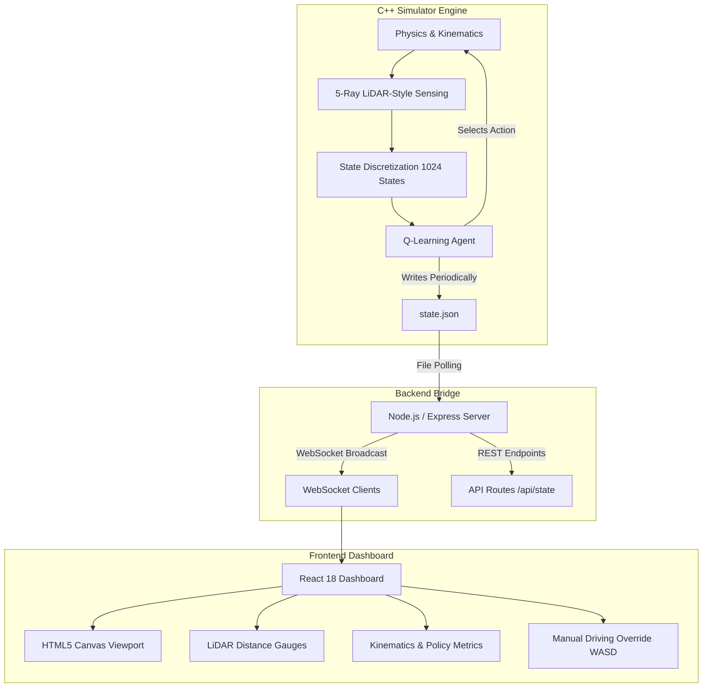

# Autonomous Vehicle Using Reinforcement Learning

[](https://isocpp.org/)
[](https://www.sfml-dev.org/)
[](https://react.dev/)
[](https://nodejs.org/)
[](LICENSE)

A 2D autonomous driving simulation in which an agent learns obstacle avoidance and navigation using Q-Learning, supported by a real-time web telemetry dashboard built with Node.js, WebSockets, and React.

Developed by **Sahil More**.

---

## Table of Contents

- [Overview](#overview)
- [System Architecture](#system-architecture)
- [Key Features](#key-features)
- [Reinforcement Learning Formulation](#reinforcement-learning-formulation)
  - [State Space Discretization](#1-state-space-discretization)
  - [Action Space](#2-action-space)
  - [Q-Learning Update Rule](#3-q-learning-update-rule)
  - [Reward Function](#4-reward-function)
- [Telemetry Dashboard](#telemetry-dashboard)
- [Repository Structure](#repository-structure)
- [Getting Started](#getting-started)
  - [Prerequisites](#prerequisites)
  - [Quickstart](#quickstart)
  - [Manual Execution](#manual-execution)
- [Telemetry API Specification](#telemetry-api-specification)
- [Demonstration](#demonstration)
- [Troubleshooting](#troubleshooting)
- [Known Limitations & Future Work](#known-limitations--future-work)
- [Author](#author)
- [License](#license)

---

## Overview

This project implements an end-to-end testbed for autonomous vehicle navigation in a 2D environment. It combines:

1. **A C++ SFML Simulation Engine**: Simulates vehicle kinematics, boundary collisions, track obstacles, and 5-ray LiDAR-style sensor distance calculations.
2. **A Tabular Q-Learning Agent**: Learns driving behavior by mapping discretized observations to control actions using temporal difference reinforcement learning.
3. **A Full-Stack Telemetry Dashboard**: A Node.js and WebSocket service streaming real-time simulation metrics to a React dashboard for visualization and policy inspection.

---

## System Architecture



---

## Key Features

- **2D Vehicle Simulation (C++ / SFML)**:
  - Planar vehicle motion with acceleration, deceleration, steering angle limits, and damping.
  - Simulated 5-ray LiDAR-style proximity sensing ($0^\circ$, $\pm 45^\circ$, $\pm 90^\circ$).
  - Ray-box intersection checks against polygonal city obstacle boundaries.
  - Native build support on macOS (Apple Silicon / Intel) and Linux via CMake.

- **Tabular Q-Learning Agent**:
  - $4^5 = 1024$ discrete states derived from bucketized sensor distances, speed, and steering.
  - 5 discrete actions: `DO_NOTHING`, `ACCELERATE`, `BRAKE`, `TURN_LEFT`, `TURN_RIGHT`.
  - $\epsilon$-greedy exploration with exponential decay.
  - State persistence to binary file checkpoint (`q_table.bin`).

- **Real-Time Telemetry Dashboard (React + Node.js)**:
  - Canvas simulation viewport rendering vehicle position, orientation, trajectory trail, and active sensor rays.
  - Decoupled simulation modes:
    - **C++ Engine Stream**: Displays live telemetry from the SFML simulation.
    - **In-Browser Simulation**: Runs a standalone client-side simulation with manual keyboard driving (**W / A / S / D** or Arrow Keys).
  - Exponential moving average sensor smoothing to eliminate meter jitter.
  - State discretization matrix inspector and reward convergence analytics.

---

## Reinforcement Learning Formulation

### 1. State Space Discretization

The vehicle observes a continuous 5-dimensional observation vector:
$$\mathbf{s} = \begin{bmatrix} d_{\text{front}}, & d_{\text{left}}, & d_{\text{right}}, & v, & \theta_{\text{steering}} \end{bmatrix}^T$$

To maintain tabular tractability with fast convergence, continuous values are discretized into **4 discrete buckets (0 to 3)**:

| Variable | Continuous Domain | Bucket 0 | Bucket 1 | Bucket 2 | Bucket 3 |
|---|---|---|---|---|---|
| **Front Distance ($d_f$)** | $[0.0, 1.0]$ | $< 0.12$ | $0.12 - 0.30$ | $0.30 - 0.60$ | $\ge 0.60$ |
| **Left Distance ($d_l$)** | $[0.0, 1.0]$ | $< 0.12$ | $0.12 - 0.30$ | $0.30 - 0.60$ | $\ge 0.60$ |
| **Right Distance ($d_r$)** | $[0.0, 1.0]$ | $< 0.12$ | $0.12 - 0.30$ | $0.30 - 0.60$ | $\ge 0.60$ |
| **Normalized Speed ($v$)** | $[-1.0, 1.0]$ | $< -0.20$ | $-0.20 - 0.15$ | $0.15 - 0.50$ | $\ge 0.50$ |
| **Steering Angle ($\theta$)** | $[-1.0, 1.0]$ | $< 0.25$ | $0.25 - 0.50$ | $0.50 - 0.75$ | $\ge 0.75$ |

The integer state index $s \in [0, 1023]$ is uniquely computed as:
$$s = d_f \cdot 4^4 + d_l \cdot 4^3 + d_r \cdot 4^2 + v \cdot 4^1 + \theta \cdot 4^0$$

### 2. Action Space

The agent selects from 5 discrete actions:
- `0`: `DO_NOTHING` — Maintain current throttle and steering angle.
- `1`: `ACCELERATE` — Increase forward speed ($+0.2\text{ px/frame}$).
- `2`: `BRAKE` — Reduce forward speed ($-0.3\text{ px/frame}$).
- `3`: `TURN_LEFT` — Adjust steering counter-clockwise ($-15^\circ$).
- `4`: `TURN_RIGHT` — Adjust steering clockwise ($+15^\circ$).

### 3. Q-Learning Update Rule

The action-value table is updated using standard off-policy Temporal Difference Q-Learning:

$$Q(s_t, a_t) \leftarrow Q(s_t, a_t) + \alpha \left[ r_{t+1} + \gamma \max_{a'} Q(s_{t+1}, a') - Q(s_t, a_t) \right]$$

- $s_t$: Current state index $[0, 1023]$.
- $a_t$: Selected action $[0, 4]$.
- $r_{t+1}$: Immediate scalar reward received after taking action $a_t$.
- $s_{t+1}$: Subsequent state index after transition.
- $\alpha$: Learning rate ($0.10$).
- $\gamma$: Discount factor ($0.95$).

Exploration is managed via $\epsilon$-greedy action selection:
$$\epsilon_{e+1} = \max(0.05, \epsilon_e \times 0.98)$$

### 4. Reward Function

$$r = r_{\text{progress}} + r_{\text{velocity}} + r_{\text{proximity}} + r_{\text{collision}}$$

- **Collision**: $-10.0$ penalty upon obstacle or boundary contact (terminal state).
- **Offroad**: $-8.0$ penalty if the vehicle exits track limits.
- **Proximity Penalty**: $-2.0$ if minimum forward distance is $< 0.15$; $-0.5$ if $< 0.35$.
- **Forward Progress**: $+0.2$ per step survived without collision.
- **Speed Incentive**: $+0.1 \times v$ to encourage forward motion over idling.

---

## Telemetry Dashboard

The dashboard provides a real-time engineering view structured into five panels:

1. **Telemetry & Cockpit**:
   - 2D canvas displaying the track map, vehicle geometry, animated 5-ray LiDAR beams, and obstacle bounding boxes.
   - Kinematic gauges for speed, heading angle, steering deflection, and active action.
   - 5-channel LiDAR distance meters with exponential moving average damping to prevent visual flicker.
2. **Q-Learning Policy**:
   - Real-time state discretization decoder showing continuous inputs mapped to active buckets.
   - Action-value bar chart displaying $Q(s, a)$ for the current state.
3. **Training Performance**:
   - Rolling cumulative reward convergence chart over training episodes.
4. **Interactive Drive Lab**:
   - Manual keyboard control override (**W / A / S / D** or Arrow Keys).
   - Simulation speed toggles ($1\times$, $2\times$, $5\times$) and vehicle position reset.
5. **System Log**:
   - Timestamped decision stream recording action selections, collisions, and episode resets.

---

## Repository Structure

```
Autonomous-Vehicle-Using-RL/
├── autonomus/
│   └── autonomous-rl-vehicle/
│       └── simulator/
│           ├── CMakeLists.txt        # Simulator build configuration
│           ├── main.cpp              # C++ SFML simulator & Q-learning engine
│           ├── assets/               # Vehicle sprite and city track image
│           ├── collision_areas.txt   # Obstacle bounding box definitions
│           ├── state.json            # Inter-process telemetry exchange file
│           ├── q_table.bin           # Saved Q-table binary weights
│           ├── build.sh              # Simulator build script
│           └── run_simulator.sh      # Simulator launcher script
│
├── rl-dashboard-nextgen/             # Telemetry Server & Dashboard
│   ├── server.js                     # Express.js & WebSocket backend
│   ├── package.json                  # Server package configuration
│   └── client/                       # React 18 frontend
│       ├── public/                   # Static assets & HTML template
│       └── src/
│           ├── App.js                # Dashboard interface & Canvas renderer
│           ├── collisionData.js      # Track obstacle coordinates
│           └── index.js              # React entrypoint
│
├── .github/
│   └── workflows/ci.yml              # Continuous integration workflow
├── start.sh                          # Universal startup script (macOS/Linux)
├── run_project.command               # macOS launcher
├── push_to_github.sh                 # Git push helper script
├── deploy.sh                         # Deployment helper script
├── Project output.mp4                # Training demonstration video
├── GITHUB_SETUP.md                   # GitHub configuration instructions
├── DEPLOYMENT.md                     # Cloud deployment guide
├── LICENSE                           # MIT License
└── README.md                         # Project documentation
```

---

## Getting Started

### Prerequisites

- **C++ Compiler**: Clang (macOS) or GCC (Linux) with **C++17** support.
- **CMake**: Version 3.16+.
- **SFML 3.x**:
  - macOS: `brew install sfml cmake`
  - Linux (Ubuntu/Debian): `sudo apt-get install libsfml-dev cmake`
- **Node.js**: Version 18.0+ and `npm`.

---

### Quickstart

Run the universal startup script from the project root:

```bash
./start.sh
```

On macOS, you can also double-click `run_project.command`.

This script will:
1. Verify the C++ simulator build (recompiling via CMake if needed).
2. Install dashboard server dependencies if not present.
3. Start the C++ simulator in the background.
4. Start the Node.js telemetry server on port 3000.
5. Open `http://localhost:3000` in your default web browser.

---

### Manual Execution

If you prefer to run each component in a dedicated terminal:

#### 1. Compile and Run the C++ Simulator

```bash
cd autonomus/autonomous-rl-vehicle/simulator
./build.sh
./run_simulator.sh
```

#### 2. Start the Telemetry Server

```bash
cd rl-dashboard-nextgen
npm install
node server.js
```

#### 3. Open the Dashboard

Open your web browser and navigate to:
```
http://localhost:3000
```

---

## Telemetry API Specification

The Node.js backend (`server.js`) exposes REST endpoints and a WebSocket stream on port 3000:

### REST Endpoints

| Endpoint | Method | Response Description |
|---|---|---|
| `/api/status` | `GET` | Simulator activity status, client count, current episode, epsilon. |
| `/api/state` | `GET` | Complete vehicle state snapshot (position, sensors, speed, action). |
| `/api/history` | `GET` | Historical episodic rewards and transition logs. |
| `/api/collision-areas` | `GET` | Track obstacle bounding rectangles `[{x, y, width, height}]`. |
| `/api/config` | `GET` | State space dimensions, action mappings, and algorithm metadata. |

### WebSocket Protocol (`ws://localhost:3000`)

Payload broadcasted on vehicle state change:

```json
{
  "type": "state_update",
  "data": {
    "episode": 61173,
    "step": 45,
    "total_reward": 12.8,
    "avg_reward": 1.4,
    "epsilon": 0.05,
    "position": { "x": 412.5, "y": 305.2 },
    "angle": 18.0,
    "speed": 2.1,
    "steering": 0.0,
    "sensors": {
      "front": 0.852,
      "front_left": 0.710,
      "front_right": 0.795,
      "left": 0.624,
      "right": 0.741
    },
    "collisions": 0,
    "last_action": "ACCELERATE",
    "window_width": 986,
    "window_height": 980
  },
  "isLive": true,
  "timestamp": "2026-10-20T14:45:00.000Z"
}
```

---

## Demonstration

A video demonstration showing agent training and collision avoidance behavior is included in the root directory:
- **`Project output.mp4`** (2.3 MB)

---

## Troubleshooting

- **Simulator fails to compile on macOS with tapi/SDK error**:
  Ensure CMake uses the active macOS SDK:
  ```bash
  cd autonomus/autonomous-rl-vehicle/simulator
  cmake -B build -S . -DCMAKE_OSX_SYSROOT="$(xcrun --sdk macosx --show-sdk-path)"
  cmake --build build
  ```
- **Dashboard shows "C++ Idle"**:
  The dashboard server is running, but the C++ simulator has not been started. Start `./run_simulator.sh` to begin streaming telemetry, or switch the dashboard to **In-Browser Sim** mode for client-side simulation.
- **Port 3000 already in use**:
  Set an alternative port:
  ```bash
  PORT=3001 node server.js
  ```

---

## Known Limitations & Future Work

- **Tabular State Space**: While tabular Q-Learning provides transparent policy inspection and fast updates, complex track layouts with dynamic traffic would benefit from function approximation (Deep Q-Networks / PPO).
- **2D Kinematic Simplification**: The simulation uses a 2D planar kinematic model rather than a full multi-body dynamic model with tire friction curves.
- **Headless Cloud Execution**: Running SFML on headless cloud servers requires a virtual framebuffer (`Xvfb`).

---

## Author

**Sahil More**

This project explores reinforcement learning, autonomous vehicle simulation, and real-time visualization through a combination of C++, SFML, React, and Node.js.

GitHub: [https://github.com/SahilMore06](https://github.com/SahilMore06)

---

## License

This project is licensed under the MIT License — see the [LICENSE](LICENSE) file for details.
